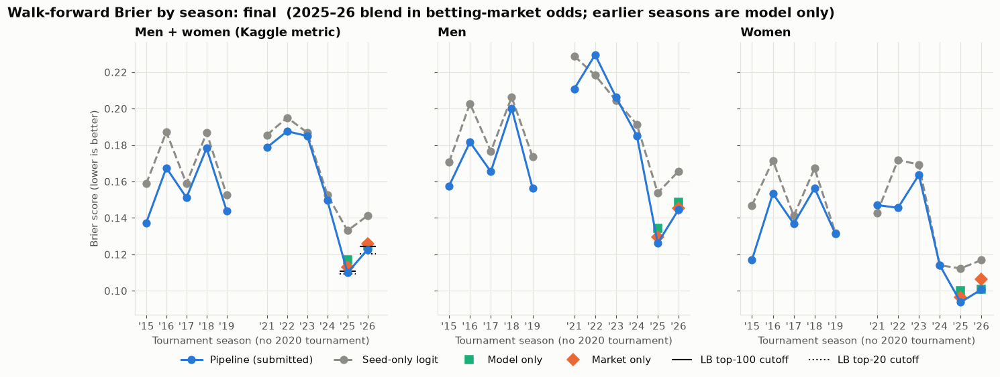
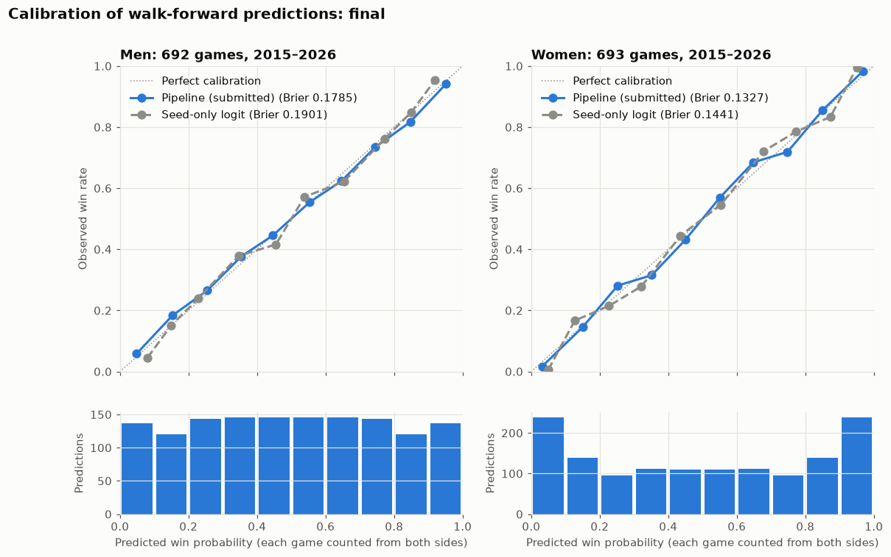
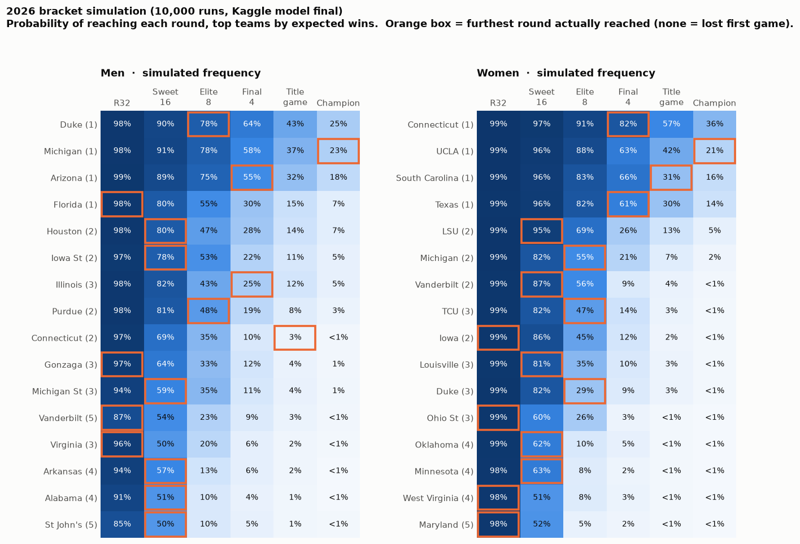
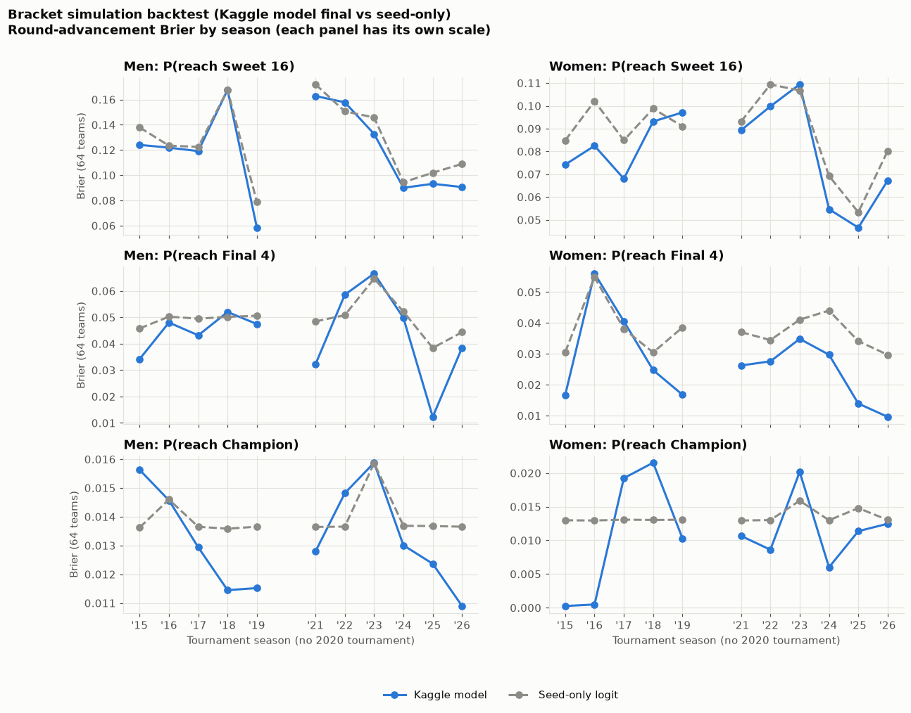

# March-Madness-Predictor

Ridge predicts a continuous NCAA tournament-win score for each team.

The Ridge training script exports `ridge_bundle.joblib` in each walk-forward
run directory under `model_outputs/ridge/`. Each joblib dictionary contains
the fitted `model`, fitted `scaler`, ordered `feature_names`, `training_seasons`,
`validation_season`, `validation_seasons`, `validation_teams`,
`validation_actual_wins`, `validation_predicted_wins`, and
`validation_residuals` (actual minus predicted). It also records a bundle
version, target, and residual source.

The all-years model exports `all_years/ridge_master_bundle.joblib`. Its error
pool comes from the historical walk-forward models, rather than predictions
on its own training data; `validation_season` is `None` and each error has its
own `validation_seasons` label. The master model and those earlier fold models
are different fits. A dataset with only one season produces no held-out pool,
so that master bundle cannot be used for simulation.

Install inference/test dependencies with `uv sync`. Install the Ridge training
dependencies with `uv sync --extra training`, then run
`uv run --extra training python models/ridge_shap.py` to train and generate bundles;
loading an existing bundle and simulating does not train anything. Legacy
model-only joblib files do not contain enough state for this interface.

```python
import joblib
from monte_carlo import simulate_team_success

bundle = joblib.load("model_outputs/ridge/Train_2005_to_2024_Val_2025/ridge_bundle.joblib")
# Supply engineered raw values for one team, as a mapping, Series, or one-row DataFrame.
result = simulate_team_success(raw_team_features, bundle, n_simulations=10000, seed=42)
```

The function aligns features to the saved order, fills absent features and
NaNs with zero (as training does), scales, predicts, and resamples validation
residuals with replacement. It returns `baseline_prediction`,
`simulated_values`, `mean`, `median`, `std` (population standard deviation),
`percentile_5`, `percentile_95`, and `probabilities`, keyed by win thresholds
1 through 6. Each probability is the fraction of simulations at or above
that threshold. The seed reproduces the samples.

Values remain continuous and unbounded; these are success-score simulations,
not calibrated bracket probabilities. SHAP is not used in the calculation.
The scaler, model, and feature schema for each validation fold use only earlier
seasons. The existing player-season CSVs still need pre-tournament data
provenance: their season totals have no tournament cutoff in the feature builder.

Run checks with `uv run python -m unittest discover -s tests`.

To simulate every team in the 2025 validation season without retraining:

```bash
uv run --extra training python run_monte_carlo.py --season 2025 \
  --bundle model_outputs/ridge/Train_2005_to_2024_Val_2025/ridge_bundle.joblib \
  --n-simulations 10000 --seed 42 --expected-teams 68
```

The runner reuses the feature builder and existing tournament-target cache.
Alternatively, `--features-csv PATH` loads already engineered team-season
features, including `team` and `season` columns. It validates the roster,
expected count, feature/scaler dimensions, finite outputs, and threshold
frequencies; matching held-out bundles also verify every baseline against
the saved prediction. No training or API call is performed by the runner.

Results are sorted by `simulated_mean` descending and saved to
`model_outputs/monte_carlo/team_success_scores_2025.csv`, with a companion
`.metadata.json` explaining provenance, validation checks, and assumptions.
Each team gets an independent seeded random stream, assigned in alphabetical
order. This reproduces a fixed roster regardless of its input row order;
individual sample draws differ from the single-team smoke test with seed 42.

## Plots

Two entry points write PNGs (plus the CSVs behind them) to the gitignored
`model_outputs/plots/`. Both need the Kaggle CSVs (see `kaggle_tuning/README.md`;
set `MANIA_DATA=/abs/path/to/mirror26`) and the training extra:

```bash
export MANIA_DATA=/abs/path/to/data/kaggle/mirror26
uv run --extra training python -m viz.kaggle               # kaggle/brier_by_season.png, kaggle/calibration.png
uv run --extra training python -m viz.bracket --season 2026  # bracket/advancement_heatmap_2026.png,
                                                             # bracket/wins_distribution_2026.png,
                                                             # bracket/advancement_brier_by_season.png
```

`viz.kaggle` refits the walk-forward backtest of `kaggle_tuning/configs/final.py:final`
(change it with `--config path.py:NAME`) once per season and gender, scoring every pair of
tournament teams. It takes about 20 seconds with 8 jobs. The predictions are cached
in `model_outputs/plots/cache/`, so `viz.bracket` and later runs reuse them. Pass
`--refresh` after changing model code. The Brier plot shows men, women and the combined
Kaggle metric by season. It compares the pipeline against a seed-only logit and, for 2025
and 2026, the model before market blending and the market alone. It also marks the
leaderboard top-100 and top-20 cutoffs.

`viz.bracket` runs `monte_carlo.simulate_bracket_tree` over each season's official
Kaggle bracket, using those pairwise probabilities. First Four winners are taken as
known. To plot a `run_monte_carlo.py` output table instead, pass
`--scores-csv model_outputs/monte_carlo/team_success_scores_shap_2025.csv`.





