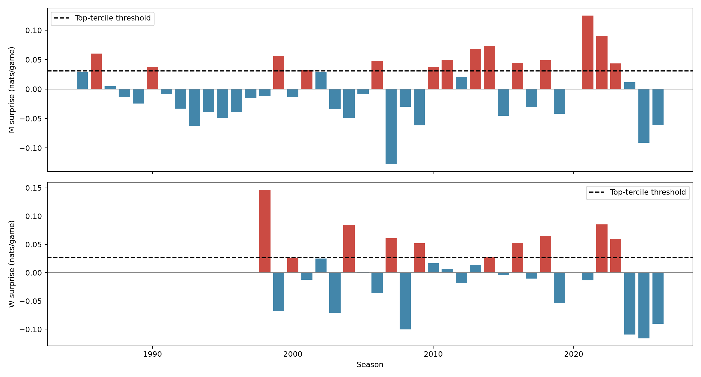
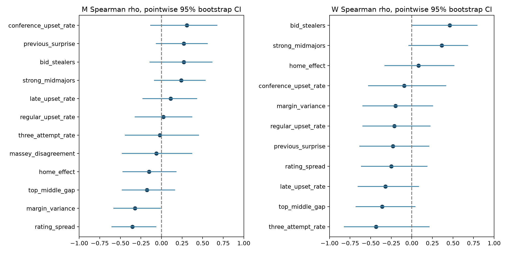
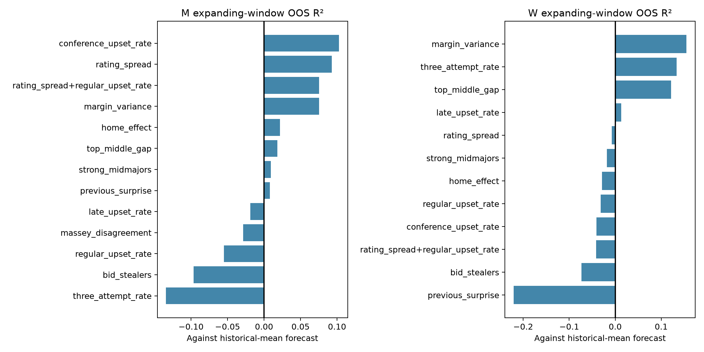

# Can we identify a bust year before the tournament?

**No usable correlation was established.**

## Design and leakage controls

Primary definition: a fixed symmetric seed-difference logistic, with no intercept, fitted leaving out the entire target season. Each season's surprise is mean actual log loss minus mean Bernoulli entropy on its actual main-bracket matchups (63, except men's 2021: 62 played games); positive means more surprising than expected. A bust is at or above that gender's full-sample 2/3 quantile (a descriptive label, not a deployable threshold). Men's 1985–2026 and women's 1998–2026 exclude 2020. First Four excluded. The separate 2026 solution supplies all 63 results per gender; the compact file ends in 2025.

LOSO uses other seasons only to define descriptive outcomes, as explicitly requested. It must not be used to train predictive backtests: expanding-window targets instead use seed-logistic coefficients fitted only on seasons before the target season (`surprise_past`). The earliest season is missing. Previous-year surprise uses this honest target and is missing in 2021 because 2020 was canceled. Every feature uses only regular-season DayNum ≤132, seeds, or Massey RankingDayNum ≤133. No end-of-season Torvik or closing-round odds are used.

Expected loss is conditional on the games actually played, which depend on earlier outcomes; this is a conditional scoring residual, not an unconditional simulation of bracket chaos. Robustness outcomes: Brier minus p(1−p); count of seed-gap ≥4 losses minus sum of their favorite-loss probabilities; negative zero-intercept calibration slope (larger = more bust); and unconditional expected minus actual top-four-seed main-bracket wins. The last propagates seed-logistic probabilities through the complete seeded bracket, including play-ins in the propagation but counting only rounds 1–6. All are in seasons.csv. No alternative definition is used to select a temperature.

## Fixed pre-tournament features

* Rating spread: standard deviation of adjusted-margin ridge ratings among the actual field (64–68 teams). Top/middle gap: mean rating of seeds 1–4 minus seeds 5–12. Ratings fit compact regular-season margins with team contrasts and signed home location, ridge alpha 10, no clipping, no carryover.
* Upset rates: losses by favorites with online Elo win probability ≥0.65, all regular games / DayNum ≥100 / conference-tournament games. Elo starts at 1500 each season, K=20, home=65; each probability is computed before its game. These measure the whole Division I season. Bid stealers: conference-tournament champions outside their conference's top two final pre-tournament ridge ratings (a fixed proxy, not an estimate of committee at-large bids).
* Margin variance: sample variance of winning margins over regular-season games. Home effect: signed location coefficient in the adjusted-margin model.
* Massey disagreement: mean across seeded teams of the standard deviation across systems of within-system rank percentiles, latest available row per system/team by day 133. Men's only; no women's ordinal dataset exists here. This is rank disagreement, not spread in strengths.
* Three-point attempt rate: total 3PA / FGA for seeded teams in regular-season detailed games. Men's detailed coverage starts 2003; women's starts 2010.
* Strong mid-majors: seeded teams ranked in the top 40 of regular-season ridge strength outside ACC, Big East, Big Ten, Big 12/8, Pac-10/12, SEC, SWC. Historical realignment is taken from each season's conference table. This fixed conference proxy has classification limitations.

No missing feature is imputed. Feature availability varies (conference tournaments and conference membership begin later); every association reports its n.

## Statistical protocol

Two-sided Spearman tests use 9,999 season permutations with +1 correction, and 4,000 paired season bootstraps for pointwise percentile 95% CIs; RNG seed 20261109. Holm correction is reported for the 23 primary gender-feature tests and separately for the full primary-plus-robustness family. CIs are not simultaneous. Exchangeability/independence is an assumption; eras and serial dependence weaken this small-sample evidence. No feature selection by 2022/23 or 2025/26 outcomes is performed.

Walk-forward: each fixed one-variable model, plus one prespecified two-variable model (rating spread + regular upset rate), uses standardized predictors and ridge alpha 10 with intercept. Start only after ten complete prior seasons. Standardization, regression, and the historical-mean baseline see prior seasons only; outcome is the past-only surprise described above. OOS R² = 1 − SSE(model)/SSE(expanding historical mean), on identical test seasons for each model. Sample sizes/windows vary with feature availability; these are exploratory validation checks, not independent confirmation after inspecting this dataset. Survival requires primary Holm p<0.05, CI excluding zero, and positive one-variable OOS R².

## Main findings

Across 41 men's and 28 women's seasons, none of the 23 primary tests survives Holm correction. The strongest primary men's association is rating spread (rho −0.353, unadjusted permutation p=0.0234, primary-family Holm p=0.5382; pointwise 95% CI −0.608 to −0.064). Its one-variable expanding-window R² is +0.093 over 30 seasons: suggestive, but insufficient after testing the stated candidate family. Women's bid-stealer proxy has rho +0.462, unadjusted p=0.0250, adjusted p=0.5500; its walk-forward R² is −0.074 over 14 seasons. Robustness tests also fail full-family correction; see the complete table below.

Both genders classify 2022 and 2023 as bust years and 2025/2026 as non-bust years under the primary definition. Men's seed-model calibration slopes in 2025/2026 are 1.693/1.386, versus 0.662/0.799 in 2022/2023. These are seed-model slopes, so they do not estimate or independently validate the betting-market slope history supplied in the task. That realized contrast does not establish a pre-tournament predictor.

## Primary associations

| gender | feature | n | rho | ci_low | ci_high | p | primary_holm_p | holm_p |
| --- | --- | --- | --- | --- | --- | --- | --- | --- |
| M | rating_spread | 41 | -0.3535 | -0.6084 | -0.0637 | 0.0234 | 0.5382 | 1.0000 |
| M | margin_variance | 41 | -0.3233 | -0.5844 | -0.0086 | 0.0391 | 0.8211 | 1.0000 |
| M | previous_surprise | 38 | 0.2717 | -0.0686 | 0.5630 | 0.0934 | 1.0000 | 1.0000 |
| M | strong_midmajors | 41 | 0.2401 | -0.0910 | 0.5374 | 0.1301 | 1.0000 | 1.0000 |
| M | conference_upset_rate | 25 | 0.3085 | -0.1368 | 0.6802 | 0.1402 | 1.0000 | 1.0000 |
| M | bid_stealers | 25 | 0.2713 | -0.1460 | 0.6178 | 0.1892 | 1.0000 | 1.0000 |
| M | top_middle_gap | 41 | -0.1775 | -0.4823 | 0.1652 | 0.2619 | 1.0000 | 1.0000 |
| M | home_effect | 41 | -0.1505 | -0.4722 | 0.1830 | 0.3458 | 1.0000 | 1.0000 |
| M | late_upset_rate | 41 | 0.1101 | -0.2312 | 0.4332 | 0.4886 | 1.0000 | 1.0000 |
| M | massey_disagreement | 23 | -0.0632 | -0.4831 | 0.3725 | 0.7676 | 1.0000 | 1.0000 |
| M | regular_upset_rate | 41 | 0.0240 | -0.3250 | 0.3726 | 0.8785 | 1.0000 | 1.0000 |
| M | three_attempt_rate | 23 | -0.0198 | -0.4460 | 0.4557 | 0.9215 | 1.0000 | 1.0000 |
| W | bid_stealers | 24 | 0.4618 | 0.0051 | 0.7968 | 0.0250 | 0.5500 | 1.0000 |
| W | top_middle_gap | 28 | -0.3618 | -0.6822 | 0.0453 | 0.0589 | 1.0000 | 1.0000 |
| W | strong_midmajors | 28 | 0.3631 | -0.0414 | 0.6832 | 0.0600 | 1.0000 | 1.0000 |
| W | late_upset_rate | 28 | -0.3218 | -0.6583 | 0.0862 | 0.0945 | 1.0000 | 1.0000 |
| W | three_attempt_rate | 16 | -0.4353 | -0.8262 | 0.2157 | 0.0964 | 1.0000 | 1.0000 |
| W | rating_spread | 28 | -0.2496 | -0.6165 | 0.1886 | 0.1965 | 1.0000 | 1.0000 |
| W | previous_surprise | 25 | -0.2308 | -0.6360 | 0.2134 | 0.2626 | 1.0000 | 1.0000 |
| W | regular_upset_rate | 28 | -0.2118 | -0.6017 | 0.2271 | 0.2760 | 1.0000 | 1.0000 |
| W | margin_variance | 28 | -0.1992 | -0.6006 | 0.2581 | 0.3143 | 1.0000 | 1.0000 |
| W | conference_upset_rate | 24 | -0.0922 | -0.5322 | 0.4177 | 0.6660 | 1.0000 | 1.0000 |
| W | home_effect | 28 | 0.0826 | -0.3336 | 0.5168 | 0.6826 | 1.0000 | 1.0000 |

## Walk-forward performance

| gender | features | n | oos_r2 |
| --- | --- | --- | --- |
| M | rating_spread | 30 | 0.0928 |
| M | top_middle_gap | 30 | 0.0184 |
| M | regular_upset_rate | 30 | -0.0552 |
| M | late_upset_rate | 30 | -0.0189 |
| M | conference_upset_rate | 15 | 0.1026 |
| M | bid_stealers | 15 | -0.0964 |
| M | margin_variance | 30 | 0.0752 |
| M | massey_disagreement | 13 | -0.0288 |
| M | three_attempt_rate | 13 | -0.1344 |
| M | strong_midmajors | 30 | 0.0095 |
| M | home_effect | 30 | 0.0217 |
| M | previous_surprise | 28 | 0.0081 |
| M | rating_spread+regular_upset_rate | 30 | 0.0754 |
| W | rating_spread | 17 | -0.0076 |
| W | top_middle_gap | 17 | 0.1211 |
| W | regular_upset_rate | 17 | -0.0313 |
| W | late_upset_rate | 17 | 0.0130 |
| W | conference_upset_rate | 14 | -0.0406 |
| W | bid_stealers | 14 | -0.0736 |
| W | margin_variance | 17 | 0.1550 |
| W | massey_disagreement | 0 | NA |
| W | three_attempt_rate | 6 | 0.1338 |
| W | strong_midmajors | 17 | -0.0180 |
| W | home_effect | 17 | -0.0289 |
| W | previous_surprise | 15 | -0.2210 |
| W | rating_spread+regular_upset_rate | 17 | -0.0416 |

## Robustness associations

| gender | outcome | feature | n | rho | ci_low | ci_high | p | holm_p |
| --- | --- | --- | --- | --- | --- | --- | --- | --- |
| M | brier_surprise | rating_spread | 41 | -0.3733 | -0.6109 | -0.0809 | 0.0158 | 1.0000 |
| M | brier_surprise | margin_variance | 41 | -0.3404 | -0.5984 | -0.0327 | 0.0303 | 1.0000 |
| M | brier_surprise | previous_surprise | 38 | 0.2748 | -0.0716 | 0.5787 | 0.0970 | 1.0000 |
| M | brier_surprise | strong_midmajors | 41 | 0.2596 | -0.0728 | 0.5552 | 0.1034 | 1.0000 |
| M | brier_surprise | conference_upset_rate | 25 | 0.2958 | -0.1420 | 0.6877 | 0.1497 | 1.0000 |
| M | brier_surprise | bid_stealers | 25 | 0.2662 | -0.1640 | 0.6264 | 0.1971 | 1.0000 |
| M | brier_surprise | top_middle_gap | 41 | -0.1918 | -0.4878 | 0.1333 | 0.2283 | 1.0000 |
| M | brier_surprise | home_effect | 41 | -0.1406 | -0.4553 | 0.2134 | 0.3872 | 1.0000 |
| M | brier_surprise | late_upset_rate | 41 | 0.0943 | -0.2435 | 0.4105 | 0.5641 | 1.0000 |
| M | brier_surprise | massey_disagreement | 23 | -0.0553 | -0.4871 | 0.3995 | 0.8037 | 1.0000 |
| M | brier_surprise | three_attempt_rate | 23 | -0.0504 | -0.4604 | 0.4108 | 0.8154 | 1.0000 |
| M | brier_surprise | regular_upset_rate | 41 | 0.0091 | -0.3503 | 0.3426 | 0.9543 | 1.0000 |
| W | brier_surprise | top_middle_gap | 28 | -0.4045 | -0.6950 | -0.0141 | 0.0345 | 1.0000 |
| W | brier_surprise | bid_stealers | 24 | 0.4290 | -0.0184 | 0.7859 | 0.0362 | 1.0000 |
| W | brier_surprise | strong_midmajors | 28 | 0.3601 | -0.0576 | 0.6711 | 0.0633 | 1.0000 |
| W | brier_surprise | late_upset_rate | 28 | -0.3361 | -0.6744 | 0.0698 | 0.0871 | 1.0000 |
| W | brier_surprise | three_attempt_rate | 16 | -0.4324 | -0.8135 | 0.1637 | 0.0955 | 1.0000 |
| W | brier_surprise | rating_spread | 28 | -0.2830 | -0.6209 | 0.1434 | 0.1485 | 1.0000 |
| W | brier_surprise | previous_surprise | 25 | -0.2408 | -0.6521 | 0.2065 | 0.2470 | 1.0000 |
| W | brier_surprise | regular_upset_rate | 28 | -0.2025 | -0.5886 | 0.2506 | 0.2963 | 1.0000 |
| W | brier_surprise | margin_variance | 28 | -0.1932 | -0.5907 | 0.2729 | 0.3238 | 1.0000 |
| W | brier_surprise | conference_upset_rate | 24 | -0.1426 | -0.5574 | 0.3706 | 0.5027 | 1.0000 |
| W | brier_surprise | home_effect | 28 | 0.0832 | -0.3546 | 0.4879 | 0.6801 | 1.0000 |
| M | gap_upset_excess | margin_variance | 41 | -0.3345 | -0.5942 | -0.0235 | 0.0311 | 1.0000 |
| M | gap_upset_excess | rating_spread | 41 | -0.3298 | -0.5701 | -0.0494 | 0.0356 | 1.0000 |
| M | gap_upset_excess | bid_stealers | 25 | 0.3336 | -0.0634 | 0.6855 | 0.1035 | 1.0000 |
| M | gap_upset_excess | previous_surprise | 38 | 0.2452 | -0.0857 | 0.5332 | 0.1434 | 1.0000 |
| M | gap_upset_excess | home_effect | 41 | -0.2066 | -0.5064 | 0.1426 | 0.1824 | 1.0000 |
| M | gap_upset_excess | top_middle_gap | 41 | -0.1765 | -0.4632 | 0.1430 | 0.2690 | 1.0000 |
| M | gap_upset_excess | conference_upset_rate | 25 | 0.2220 | -0.2467 | 0.6147 | 0.2768 | 1.0000 |
| M | gap_upset_excess | late_upset_rate | 41 | 0.1695 | -0.1504 | 0.4770 | 0.2906 | 1.0000 |
| M | gap_upset_excess | strong_midmajors | 41 | 0.1218 | -0.2063 | 0.4437 | 0.4502 | 1.0000 |
| M | gap_upset_excess | three_attempt_rate | 23 | 0.0978 | -0.3731 | 0.5440 | 0.6480 | 1.0000 |
| M | gap_upset_excess | massey_disagreement | 23 | -0.0939 | -0.5147 | 0.3516 | 0.6653 | 1.0000 |
| M | gap_upset_excess | regular_upset_rate | 41 | 0.0399 | -0.2885 | 0.3416 | 0.8042 | 1.0000 |
| W | gap_upset_excess | bid_stealers | 24 | 0.5577 | 0.1093 | 0.8840 | 0.0041 | 0.4715 |
| W | gap_upset_excess | strong_midmajors | 28 | 0.4277 | 0.0164 | 0.7249 | 0.0223 | 1.0000 |
| W | gap_upset_excess | top_middle_gap | 28 | -0.3519 | -0.6880 | 0.0840 | 0.0697 | 1.0000 |
| W | gap_upset_excess | three_attempt_rate | 16 | -0.4265 | -0.8198 | 0.2108 | 0.0992 | 1.0000 |
| W | gap_upset_excess | late_upset_rate | 28 | -0.2419 | -0.6194 | 0.1860 | 0.2235 | 1.0000 |
| W | gap_upset_excess | margin_variance | 28 | -0.2304 | -0.6203 | 0.2035 | 0.2387 | 1.0000 |
| W | gap_upset_excess | regular_upset_rate | 28 | -0.2085 | -0.6077 | 0.2399 | 0.2806 | 1.0000 |
| W | gap_upset_excess | previous_surprise | 25 | -0.2185 | -0.6355 | 0.2147 | 0.2870 | 1.0000 |
| W | gap_upset_excess | rating_spread | 28 | -0.1866 | -0.5757 | 0.2717 | 0.3387 | 1.0000 |
| W | gap_upset_excess | conference_upset_rate | 24 | 0.1330 | -0.3569 | 0.6079 | 0.5375 | 1.0000 |
| W | gap_upset_excess | home_effect | 28 | 0.1171 | -0.3128 | 0.5299 | 0.5450 | 1.0000 |
| M | slope_bust | rating_spread | 41 | -0.3659 | -0.6127 | -0.0753 | 0.0194 | 1.0000 |
| M | slope_bust | margin_variance | 41 | -0.3352 | -0.5930 | -0.0230 | 0.0330 | 1.0000 |
| M | slope_bust | previous_surprise | 38 | 0.2815 | -0.0776 | 0.5782 | 0.0885 | 1.0000 |
| M | slope_bust | strong_midmajors | 41 | 0.2588 | -0.0704 | 0.5584 | 0.1056 | 1.0000 |
| M | slope_bust | conference_upset_rate | 25 | 0.2954 | -0.1427 | 0.6781 | 0.1501 | 1.0000 |
| M | slope_bust | bid_stealers | 25 | 0.2662 | -0.1572 | 0.6137 | 0.1877 | 1.0000 |
| M | slope_bust | top_middle_gap | 41 | -0.1787 | -0.4722 | 0.1559 | 0.2656 | 1.0000 |
| M | slope_bust | home_effect | 41 | -0.1505 | -0.4688 | 0.2174 | 0.3456 | 1.0000 |
| M | slope_bust | late_upset_rate | 41 | 0.1131 | -0.2429 | 0.4408 | 0.4829 | 1.0000 |
| M | slope_bust | massey_disagreement | 23 | -0.0751 | -0.5107 | 0.3738 | 0.7376 | 1.0000 |
| M | slope_bust | regular_upset_rate | 41 | 0.0307 | -0.3100 | 0.3710 | 0.8469 | 1.0000 |
| M | slope_bust | three_attempt_rate | 23 | -0.0099 | -0.4448 | 0.4434 | 0.9600 | 1.0000 |
| W | slope_bust | bid_stealers | 24 | 0.4618 | 0.0154 | 0.7961 | 0.0246 | 1.0000 |
| W | slope_bust | top_middle_gap | 28 | -0.3645 | -0.6830 | 0.0466 | 0.0555 | 1.0000 |
| W | slope_bust | strong_midmajors | 28 | 0.3631 | -0.0418 | 0.6834 | 0.0614 | 1.0000 |
| W | slope_bust | late_upset_rate | 28 | -0.3290 | -0.6560 | 0.0872 | 0.0888 | 1.0000 |
| W | slope_bust | three_attempt_rate | 16 | -0.4353 | -0.8318 | 0.1867 | 0.0955 | 1.0000 |
| W | slope_bust | rating_spread | 28 | -0.2540 | -0.6132 | 0.1842 | 0.1857 | 1.0000 |
| W | slope_bust | regular_upset_rate | 28 | -0.2162 | -0.6210 | 0.2273 | 0.2659 | 1.0000 |
| W | slope_bust | previous_surprise | 25 | -0.2308 | -0.6421 | 0.2311 | 0.2775 | 1.0000 |
| W | slope_bust | margin_variance | 28 | -0.2003 | -0.5966 | 0.2416 | 0.3099 | 1.0000 |
| W | slope_bust | home_effect | 28 | 0.0854 | -0.3374 | 0.5048 | 0.6617 | 1.0000 |
| W | slope_bust | conference_upset_rate | 24 | -0.0922 | -0.5448 | 0.4082 | 0.6681 | 1.0000 |
| M | top4_deficit | rating_spread | 41 | -0.4181 | -0.6563 | -0.1124 | 0.0088 | 1.0000 |
| M | top4_deficit | margin_variance | 41 | -0.2974 | -0.5450 | -0.0017 | 0.0562 | 1.0000 |
| M | top4_deficit | conference_upset_rate | 25 | 0.3128 | -0.0744 | 0.6270 | 0.1320 | 1.0000 |
| M | top4_deficit | previous_surprise | 38 | 0.2144 | -0.1532 | 0.5238 | 0.1968 | 1.0000 |
| M | top4_deficit | top_middle_gap | 41 | -0.1796 | -0.4768 | 0.1412 | 0.2546 | 1.0000 |
| M | top4_deficit | strong_midmajors | 41 | 0.1580 | -0.1844 | 0.4778 | 0.3213 | 1.0000 |
| M | top4_deficit | regular_upset_rate | 41 | -0.1373 | -0.4753 | 0.2206 | 0.3934 | 1.0000 |
| M | top4_deficit | three_attempt_rate | 23 | -0.1196 | -0.5553 | 0.3599 | 0.5844 | 1.0000 |
| M | top4_deficit | bid_stealers | 25 | 0.0963 | -0.3236 | 0.5108 | 0.6424 | 1.0000 |
| M | top4_deficit | late_upset_rate | 41 | -0.0718 | -0.4137 | 0.2919 | 0.6519 | 1.0000 |
| M | top4_deficit | home_effect | 41 | 0.0085 | -0.3059 | 0.3204 | 0.9573 | 1.0000 |
| M | top4_deficit | massey_disagreement | 23 | -0.0030 | -0.4233 | 0.4154 | 0.9913 | 1.0000 |
| W | top4_deficit | rating_spread | 28 | -0.3629 | -0.6662 | 0.0099 | 0.0564 | 1.0000 |
| W | top4_deficit | three_attempt_rate | 16 | -0.4618 | -0.8393 | 0.1599 | 0.0726 | 1.0000 |
| W | top4_deficit | conference_upset_rate | 24 | -0.3365 | -0.6806 | 0.1183 | 0.1073 | 1.0000 |
| W | top4_deficit | top_middle_gap | 28 | -0.2868 | -0.5762 | 0.0562 | 0.1376 | 1.0000 |
| W | top4_deficit | late_upset_rate | 28 | -0.2704 | -0.6070 | 0.1270 | 0.1618 | 1.0000 |
| W | top4_deficit | margin_variance | 28 | -0.2222 | -0.5713 | 0.1953 | 0.2569 | 1.0000 |
| W | top4_deficit | previous_surprise | 25 | -0.1669 | -0.5666 | 0.2445 | 0.4199 | 1.0000 |
| W | top4_deficit | home_effect | 28 | 0.1461 | -0.2398 | 0.5036 | 0.4485 | 1.0000 |
| W | top4_deficit | strong_midmajors | 28 | 0.1248 | -0.2913 | 0.5024 | 0.5232 | 1.0000 |
| W | top4_deficit | regular_upset_rate | 28 | -0.1182 | -0.4814 | 0.2900 | 0.5478 | 1.0000 |
| W | top4_deficit | bid_stealers | 24 | 0.0968 | -0.3341 | 0.4923 | 0.6505 | 1.0000 |

## Season table

Units are nats per game for log loss/surprise; counts for gap-upset excess and top-four deficit. Slope is favorable-model calibration (lower = more bust).

| gender | Season | games | log_loss | expected_log_loss | surprise | bust | brier_surprise | gap_upset_excess | calibration_slope | top4_deficit |
| --- | --- | --- | --- | --- | --- | --- | --- | --- | --- | --- |
| M | 1985 | 63 | 0.5736 | 0.5450 | 0.0286 | no | 0.0160 | 3.6802 | 0.8748 | 0.1419 |
| M | 1986 | 63 | 0.6014 | 0.5410 | 0.0604 | yes | 0.0260 | 3.1868 | 0.7577 | 4.1869 |
| M | 1987 | 63 | 0.5514 | 0.5465 | 0.0049 | no | 0.0033 | -1.2002 | 0.9772 | 2.1081 |
| M | 1988 | 63 | 0.5411 | 0.5551 | -0.0139 | no | -0.0041 | -0.1848 | 1.0733 | 2.0811 |
| M | 1989 | 63 | 0.5325 | 0.5569 | -0.0244 | no | -0.0078 | -0.1176 | 1.1344 | -5.9340 |
| M | 1990 | 63 | 0.5860 | 0.5488 | 0.0372 | yes | 0.0195 | 3.3491 | 0.8358 | 1.1541 |
| M | 1991 | 63 | 0.5507 | 0.5591 | -0.0084 | no | -0.0047 | -0.2272 | 1.0450 | -4.9110 |
| M | 1992 | 63 | 0.5293 | 0.5623 | -0.0330 | no | -0.0133 | -0.7445 | 1.1965 | -0.9464 |
| M | 1993 | 63 | 0.5018 | 0.5642 | -0.0624 | no | -0.0283 | -2.6160 | 1.4222 | -2.9891 |
| M | 1994 | 63 | 0.5166 | 0.5554 | -0.0388 | no | -0.0139 | -1.0822 | 1.2214 | -5.9548 |
| M | 1995 | 63 | 0.5105 | 0.5592 | -0.0488 | no | -0.0221 | -4.0380 | 1.2942 | -3.9693 |
| M | 1996 | 63 | 0.5173 | 0.5560 | -0.0387 | no | -0.0141 | -1.1517 | 1.2216 | -4.9547 |
| M | 1997 | 63 | 0.5470 | 0.5625 | -0.0155 | no | -0.0082 | -3.9470 | 1.0862 | -0.9212 |
| M | 1998 | 63 | 0.5482 | 0.5607 | -0.0125 | no | -0.0038 | -1.0098 | 1.0684 | -2.9169 |
| M | 1999 | 63 | 0.5949 | 0.5385 | 0.0564 | yes | 0.0277 | 1.3134 | 0.7744 | 0.1813 |
| M | 2000 | 63 | 0.5500 | 0.5634 | -0.0134 | no | -0.0017 | 0.0580 | 1.0745 | 6.0819 |
| M | 2001 | 63 | 0.5802 | 0.5486 | 0.0317 | yes | 0.0154 | 2.1486 | 0.8585 | -0.8537 |
| M | 2002 | 63 | 0.5749 | 0.5457 | 0.0292 | no | 0.0158 | 3.2261 | 0.8721 | 0.1428 |
| M | 2003 | 63 | 0.5213 | 0.5556 | -0.0343 | no | -0.0115 | -2.4478 | 1.1927 | -2.9483 |
| M | 2004 | 63 | 0.5131 | 0.5623 | -0.0492 | no | -0.0194 | -1.8382 | 1.3044 | -2.9699 |
| M | 2005 | 63 | 0.5455 | 0.5541 | -0.0086 | no | -0.0019 | -1.2027 | 1.0439 | 2.0888 |
| M | 2006 | 63 | 0.5901 | 0.5422 | 0.0479 | yes | 0.0234 | 2.7653 | 0.8015 | -1.8308 |
| M | 2007 | 63 | 0.4432 | 0.5708 | -0.1276 | no | -0.0544 | -5.5404 | 2.4063 | -7.0848 |
| M | 2008 | 63 | 0.5274 | 0.5577 | -0.0303 | no | -0.0118 | 0.1436 | 1.1731 | -3.9425 |
| M | 2009 | 63 | 0.4982 | 0.5598 | -0.0616 | no | -0.0243 | -2.2133 | 1.4020 | -8.9879 |
| M | 2010 | 63 | 0.5821 | 0.5444 | 0.0376 | yes | 0.0193 | 1.6758 | 0.8388 | 4.1547 |
| M | 2011 | 63 | 0.6007 | 0.5510 | 0.0498 | yes | 0.0250 | 4.4155 | 0.7823 | 1.1719 |
| M | 2012 | 63 | 0.5732 | 0.5527 | 0.0206 | no | 0.0072 | 0.9948 | 0.9028 | -2.8695 |
| M | 2013 | 63 | 0.6130 | 0.5452 | 0.0678 | yes | 0.0290 | 2.6960 | 0.7234 | -1.8026 |
| M | 2014 | 63 | 0.6214 | 0.5478 | 0.0736 | yes | 0.0364 | 5.7941 | 0.7002 | 3.2055 |
| M | 2015 | 63 | 0.5176 | 0.5630 | -0.0454 | no | -0.0200 | -1.2553 | 1.2800 | -0.9644 |
| M | 2016 | 63 | 0.5912 | 0.5464 | 0.0448 | yes | 0.0193 | 2.0148 | 0.8085 | 0.1649 |
| M | 2017 | 63 | 0.5237 | 0.5543 | -0.0306 | no | -0.0102 | 1.2268 | 1.1670 | -4.9430 |
| M | 2018 | 63 | 0.6006 | 0.5513 | 0.0493 | yes | 0.0207 | 3.3038 | 0.7850 | 4.1712 |
| M | 2019 | 63 | 0.5150 | 0.5571 | -0.0420 | no | -0.0146 | -1.4792 | 1.2470 | -6.9595 |
| M | 2021 | 62 | 0.6547 | 0.5297 | 0.1250 | yes | 0.0532 | 5.9215 | 0.5737 | 5.2745 |
| M | 2022 | 63 | 0.6283 | 0.5381 | 0.0902 | yes | 0.0398 | 6.0147 | 0.6617 | 1.2288 |
| M | 2023 | 63 | 0.6018 | 0.5584 | 0.0434 | yes | 0.0161 | 1.9918 | 0.7985 | 6.1629 |
| M | 2024 | 63 | 0.5603 | 0.5488 | 0.0114 | no | 0.0074 | 1.1482 | 0.9466 | -2.8826 |
| M | 2025 | 63 | 0.4715 | 0.5629 | -0.0914 | no | -0.0381 | -4.1186 | 1.6932 | -8.0315 |
| M | 2026 | 63 | 0.4982 | 0.5592 | -0.0610 | no | -0.0237 | -1.6132 | 1.3865 | -5.9870 |
| W | 1998 | 63 | 0.5767 | 0.4301 | 0.1466 | yes | 0.0514 | 3.7634 | 0.6194 | 0.5448 |
| W | 1999 | 63 | 0.3954 | 0.4635 | -0.0682 | no | -0.0233 | -1.3372 | 1.4134 | -6.7118 |
| W | 2000 | 63 | 0.4664 | 0.4396 | 0.0268 | yes | 0.0116 | 1.0214 | 0.9039 | -2.5962 |
| W | 2001 | 63 | 0.4432 | 0.4559 | -0.0128 | no | -0.0003 | -0.0152 | 1.0558 | 0.3561 |
| W | 2002 | 63 | 0.4662 | 0.4412 | 0.0250 | no | 0.0116 | 2.8563 | 0.9104 | -2.5983 |
| W | 2003 | 63 | 0.3901 | 0.4609 | -0.0707 | no | -0.0273 | -3.0352 | 1.4057 | 0.2850 |
| W | 2004 | 63 | 0.5160 | 0.4319 | 0.0841 | yes | 0.0363 | 2.9905 | 0.7523 | 2.4719 |
| W | 2005 | 63 | 0.4482 | 0.4474 | 0.0007 | no | 0.0004 | -1.0111 | 0.9970 | -1.6276 |
| W | 2006 | 63 | 0.4221 | 0.4579 | -0.0357 | no | -0.0137 | 1.2830 | 1.1740 | -3.6719 |
| W | 2007 | 63 | 0.5003 | 0.4393 | 0.0610 | yes | 0.0247 | 2.6291 | 0.8025 | 0.4446 |
| W | 2008 | 63 | 0.3677 | 0.4679 | -0.1002 | no | -0.0380 | -3.3761 | 1.7517 | -2.7517 |
| W | 2009 | 63 | 0.4928 | 0.4410 | 0.0518 | yes | 0.0251 | 1.8672 | 0.8284 | -0.5663 |
| W | 2010 | 63 | 0.4627 | 0.4462 | 0.0165 | no | 0.0092 | 1.6769 | 0.9383 | -2.6085 |
| W | 2011 | 63 | 0.4563 | 0.4498 | 0.0065 | no | 0.0089 | -0.6804 | 0.9743 | 1.3794 |
| W | 2012 | 63 | 0.4304 | 0.4490 | -0.0187 | no | -0.0119 | 0.7406 | 1.0812 | -1.6511 |
| W | 2013 | 63 | 0.4600 | 0.4459 | 0.0141 | no | 0.0109 | -1.7142 | 0.9471 | 2.3885 |
| W | 2014 | 63 | 0.4718 | 0.4437 | 0.0281 | yes | 0.0149 | 1.8019 | 0.8980 | -2.5946 |
| W | 2015 | 63 | 0.4411 | 0.4455 | -0.0045 | no | 0.0019 | 1.8750 | 1.0181 | -2.6338 |
| W | 2016 | 63 | 0.4967 | 0.4440 | 0.0527 | yes | 0.0287 | 1.6016 | 0.8245 | 1.4348 |
| W | 2017 | 63 | 0.4385 | 0.4491 | -0.0107 | no | -0.0064 | 0.2329 | 1.0455 | -2.6414 |
| W | 2018 | 63 | 0.4945 | 0.4295 | 0.0650 | yes | 0.0301 | 2.7809 | 0.7981 | -1.5507 |
| W | 2019 | 63 | 0.4034 | 0.4572 | -0.0538 | no | -0.0192 | -2.0304 | 1.2866 | -2.6941 |
| W | 2021 | 63 | 0.4375 | 0.4511 | -0.0136 | no | -0.0041 | -1.3304 | 1.0563 | 1.3551 |
| W | 2022 | 63 | 0.5125 | 0.4271 | 0.0854 | yes | 0.0356 | 2.5513 | 0.7508 | -0.5266 |
| W | 2023 | 63 | 0.5027 | 0.4433 | 0.0594 | yes | 0.0263 | 2.0881 | 0.8054 | -0.5573 |
| W | 2024 | 63 | 0.3620 | 0.4714 | -0.1094 | no | -0.0434 | -2.2616 | 1.8667 | -3.7632 |
| W | 2025 | 63 | 0.3560 | 0.4719 | -0.1160 | no | -0.0446 | -3.9034 | 2.1071 | -3.7714 |
| W | 2026 | 63 | 0.3758 | 0.4660 | -0.0903 | no | -0.0364 | -2.0662 | 1.6106 | -2.7392 |

## Artifacts and reproduction

Full precision: [seasons/features](bust_years/seasons.csv), [all tests](bust_years/associations.csv), [walk-forward scores](bust_years/walk_forward.csv), [individual predictions](bust_years/predictions.csv).

Run: `MANIA_DATA=/Users/spro/code/March-Madness-Predictor/data/kaggle/mirror26 OMP_NUM_THREADS=1 uv run python -m kaggle_tuning.research.bust_years`.

## Decision and modeling guard

No predictor passes the statistical-plus-walk-forward gate. The requested conditional temperature experiment is therefore skipped: no bust-adjusted config is created, and no historical-guard gain is claimed. Existing configs and model code are unchanged. A null result does not prove no underlying signal exists; these season counts do not justify a deployable adjustment.

## Unchanged reference-model reproduction

Scores below were recomputed through `all_years.all_pair_predictions` and `all_years.score_year`, with three workers. Hist and 2015–2019 are model-only mean game Brier across seasons (no external blend). No candidate config was tested because the research gate failed.

| Config | hist 2015–2024 | 2015–2019 |
| --- | --- | --- |
| allyears_EXT | 0.16248122 | 0.15501153 |
| combined_BEST | 0.16326793 | 0.15520000 |

| Config | Season | Metric | Score / rank |
| --- | --- | --- | --- |
| allyears_EXT | 2021 | log loss | M 0.58826 / #47; W 0.41892 / #21 |
| allyears_EXT | 2022 | log loss | M 0.62011 / #184; W 0.44054 / #132 |
| allyears_EXT | 2023 | Brier | 0.18424 / #161 |
| allyears_EXT | 2024 | bracket Brier | 0.05734 / #19 |
| allyears_EXT | 2025 | Brier | 0.10796 / #10 |
| allyears_EXT | 2026 | Brier | 0.12122 / #31 |
| combined_BEST | 2021 | log loss | M 0.59639 / #81; W 0.43140 / #35 |
| combined_BEST | 2022 | log loss | M 0.64912 / #418; W 0.43656 / #103 |
| combined_BEST | 2023 | Brier | 0.18649 / #237 |
| combined_BEST | 2024 | bracket Brier | 0.05774 / #25 |
| combined_BEST | 2025 | Brier | 0.10797 / #10 |
| combined_BEST | 2026 | Brier | 0.12122 / #31 |

Exact unchanged config dictionaries and full-precision scores: [baseline.json](bust_years/baseline.json).
No proposed change failed the 2015–2019 Brier guard: the statistical screening failed first, and no temperature was fitted.
